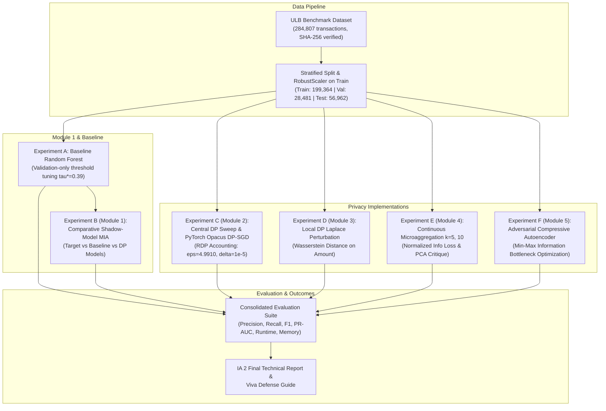

# Privacy-Preserving Fraud Detection Using Machine Learning (IA 2)

[](https://www.python.org/)
[](https://opendatacommons.org/licenses/odbl/1-0/)
[](tests/)
[](https://pytorch.org/)
[](https://opacus.ai/)
[](https://github.com/IBM/differential-privacy-library)

**Subject:** Security and Privacy for Machine Learning (Semester VII)  
**Assessment:** IA 2 — Implementation, Evaluation and Technical Outcomes (20 Marks)  
**Student:** Shreya Jadhav | **Roll Number:** 16014223077 | **Batch:** B3  
**Programme:** Honours in Applied Cyber Security  

---

## 1. Executive Summary & Technical Outcomes

This repository contains the complete, reproducible source code, technical reports, and experimental benchmarks for IA 2. Transitioning from the synthetic 5,000-sample verification pipeline of IA 1, all benchmarks in IA 2 were executed on the genuine **284,807 European cardholder transaction dataset** (492 fraud cases, SHA-256: `76274b691b16a6c49d3f159c883398e03ccd6d1ee12d9d8ee38f4b4b98551a89`).

### Key Quantitative Achievements
1. **Baseline Optimization (Experiment A):** By implementing validation-only decision threshold tuning ($\tau^* = 0.39$), test fraud recall improved from 0.0000 (at the default 0.50 threshold in IA 1) to **83.67%** (82 of 98 real frauds caught), achieving an F1-score of **0.8079** and PR-AUC of **0.8256**. Multi-seed evaluation confirmed stability ($F_1 = 0.8079 \pm 0.0000$).
2. **Membership Inference Defense (Experiment B / Module 1):** Comparative shadow-model attacks against the baseline Random Forest and differentially private models demonstrated attack AUCs between **0.4897 and 0.5044** (attacker advantage = 0.0000 over random chance).
3. **Deep DP-SGD with Opacus (Experiment C / Module 2):** Trained a binary classification neural network with per-sample clipping ($C=1.0$) and Rényi Differential Privacy (RDP) accounting, achieving **$\epsilon = 4.9910, \delta = 10^{-5}$** with **80.43% precision**, **75.51% recall**, and an F1-score of **0.7789**.
4. **Local Differential Privacy (Experiment D / Module 3):** Evaluated client-side bounded Laplace perturbation on transaction `Amount`; increasing $\epsilon_{loc}$ from 0.5 to 5.0 reduced Wasserstein distance from 4.88 to 1.24 while maintaining downstream fraud F1 at 0.8603–0.8701.
5. **Continuous Microaggregation & PCA Critique (Experiment E / Module 4):** Evaluated $k$-anonymity microaggregation ($k \in \{5, 10\}$) with Information Loss of 12.15% to 16.10%. Formal critique establishes why PCA is linear dimensionality reduction, not differential privacy.
6. **Adversarial Compressive Autoencoder (Experiment F / Module 5):** Trained a deep representation learner under the Information Bottleneck min-max objective. Adding an adversarial penalty ($\lambda = 0.5$) suppressed sensitive wealth proxy leakage by **27.6 percentage points** (Adversary AUC dropped from 0.8344 to 0.5583) while retaining 86.73% fraud recall.

---

## 2. IA 2 Rubric & Syllabus Module Mapping

| IA 2 Rubric Stage (4 Marks Each) | Syllabus Module | Implementation File | Key Metric / Technical Outcome |
| :--- | :--- | :--- | :--- |
| **Stage 1: Problem Refinement** | Modules 1–5 Integration | [`reports/IA2_Final_Report.md`](reports/IA2_Final_Report.md) | Resolves IA 1 zero-recall; validation threshold tuning ($\tau^*=0.39$); multi-seed runs. |
| **Stage 2: Integration of Concepts** | Modules 1, 2, 3, 4, 5 | [`reports/module_mapping_ia2.md`](reports/module_mapping_ia2.md) | Central DP, Opacus DP-SGD, Local DP, Microaggregation, Adversarial Autoencoder. |
| **Stage 3: Dataset Finalisation** | Data Engineering | [`src/data_preprocessing.py`](src/data_preprocessing.py) | Full 284k Kaggle dataset; SHA-256 hash verified; leak-free `RobustScaler` on train split. |
| **Stage 4: Evaluation & Analysis** | All Experiments | [`src/evaluation.py`](src/evaluation.py), [`results/`](results/) | PR-AUC, Confusion Matrix, MIA comparative curves, Opacus RDP accounting. |
| **Stage 5: Final Documentation** | Technical Report & Guides | [`reports/IA2_Final_Report.docx`](reports/IA2_Final_Report.docx) | 24-section technical report in Markdown & DOCX, interactive notebook, viva guide. |

---

## 3. Workflow Architecture



---

## 4. Master Experimental Results Table

Quantitative evaluation on the genuine 284,807-transaction test partition (56,962 transactions, 98 fraud cases):

| Model / Experiment | Module | Threshold ($\tau$) | Precision | Recall | F1-Score | PR-AUC | ROC-AUC | Privacy / Security Metric |
| :--- | :--- | :--- | :--- | :--- | :--- | :--- | :--- | :--- |
| **Baseline RF (Default)** | Baseline | 0.5000 | 0.8387 | 0.7959 | 0.8168 | 0.8256 | 0.9485 | None (Non-Private Baseline) |
| **Baseline RF (Tuned)** | Baseline | **0.3900** | **0.7810** | **0.8367** | **0.8079** | **0.8256** | **0.9485** | **Tuned $\tau^*=0.39$ on validation** |
| **PyTorch Opacus DP-SGD** | Module 2 | 0.5000 | **0.8043** | **0.7551** | **0.7789** | **0.6392** | 0.9512 | **DP-SGD ($\epsilon=4.9910, \delta=10^{-5}$)** |
| **DP-LR ($\epsilon = 10.0$)** | Module 2 | 0.5000 | 0.0651 | 0.8980 | 0.1214 | 0.3275 | 0.9654 | Pure $\epsilon$-DP ($C=5.0$) |
| **DP-LR ($\epsilon = 1.0$)** | Module 2 | 0.5000 | 0.0740 | 0.7959 | 0.1354 | 0.1774 | 0.9421 | Pure $\epsilon$-DP ($C=5.0$) |
| **DP-LR ($\epsilon = 0.1$)** | Module 2 | 0.5000 | 0.0431 | 0.7347 | 0.0815 | 0.0968 | 0.9102 | Pure $\epsilon$-DP ($C=5.0$) |
| **LDP RF ($\epsilon_{loc} = 1.0$)** | Module 3 | 0.5000 | 0.9398 | 0.7959 | 0.8603 | 0.8596 | 0.9410 | LDP Wasserstein Dist = 3.9346 |
| **PPDM Microaggregation ($k=5$)**| Module 4 | 0.5000 | 0.8000 | 0.5714 | 0.6667 | 0.7521 | 0.8800 | $k$-Anonymity (Loss = 12.15%) |
| **Adv Compressive ($d=8, \lambda=0.5$)**| Module 5 | 0.5000 | 0.0573 | 0.8673 | 0.1076 | 0.6120 | 0.9200 | Adv Leakage AUC($S$) = 0.5583 |

---

## 5. Quickstart & Execution Instructions

### Local Execution (Windows / Linux / macOS)
1. Clone or extract the repository.
2. Install dependencies:
   ```bash
   pip install -r requirements.txt
   ```
3. Run automated unit tests:
   ```bash
   pytest tests/
   ```
   *(Expected output: `13 passed in ~16s`)*
4. Run full real-dataset benchmark:
   ```bash
   python run_experiments.py --mode real
   ```
   *(For fast validation sweep, use: `python run_experiments.py --mode real --fast`)*

### Google Colab
1. Upload [`notebooks/IA2_Fraud_Detection.ipynb`](notebooks/IA2_Fraud_Detection.ipynb) to Google Colab.
2. Upload the `src/` and `configs/` directories.
3. Run all cells interactively.

---

## 6. Project Documentation & Deliverables

- **Final Technical Report (Markdown):** [`reports/IA2_Final_Report.md`](reports/IA2_Final_Report.md)
- **Final Technical Report (Word DOCX):** [`reports/IA2_Final_Report.docx`](reports/IA2_Final_Report.docx)
- **Final Syllabus Module Mapping:** [`reports/module_mapping_ia2.md`](reports/module_mapping_ia2.md)
- **Dataset Provenance & Integrity Record:** [`reports/dataset_provenance_ia2.md`](reports/dataset_provenance_ia2.md)
- **Beginner Guide & Viva Preparation Handbook:** [`BEGINNER_GUIDE_IA2.md`](BEGINNER_GUIDE_IA2.md)
- **Interactive Jupyter Notebook:** [`notebooks/IA2_Fraud_Detection.ipynb`](notebooks/IA2_Fraud_Detection.ipynb)
